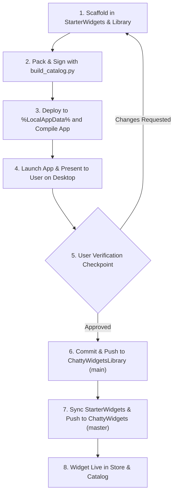

# Packaging, Testing, and Publishing Workflow

This document defines the strict, multi-stage pipeline for developing, locally testing, and officially publishing a ChattyWidgets widget.

## Pipeline Overview



---

## Stage 1: Scaffolding and Directory Sync

Place the source files in both the engine starter widgets folder and the official library:

1. `C:\Users\ChattyNB\Projects\chattywidgets\StarterWidgets\<widget-id>\`
   - `manifest.json`
   - `Widget.xaml`
   - Assets/icons (if any)
2. `C:\Users\ChattyNB\Projects\ChattyWidgetsLibrary\widgets\<widget-id>\`
   - Same files mirrored.

---

## Stage 2: Packaging & Cryptographic Signing

In `C:\Users\ChattyNB\Projects\ChattyWidgetsLibrary`:

```powershell
python scripts/build_catalog.py
```

This script:
1. Validates `manifest.json`.
2. Packages the widget into a zip archive with extension `.chw`.
3. Cryptographically signs the payload with RSA private key (`keys/official_private.pem`).
4. Generates a signed `signature.json` inside the package.
5. Updates `catalog.json` with SHA-256 hash, size, and metadata.

---

## Stage 3: Local Deployment & App Compilation

Copy the generated `.chw` package to the active runtime locations:

```powershell
# 1. Sync .chw to StarterWidgets and installed local folder
Copy-Item "packages\<widget-id>.chw" "C:\Users\ChattyNB\Projects\chattywidgets\StarterWidgets\" -Force
Copy-Item "packages\<widget-id>.chw" "$env:LOCALAPPDATA\ChattyWidgets\widgets\" -Force
Copy-Item "catalog.json" "C:\Users\ChattyNB\Projects\chattywidgets\StarterWidgets\catalog.json" -Force

# 2. Build the main solution
cd C:\Users\ChattyNB\Projects\chattywidgets
dotnet build ChattyWidgets.csproj -c Debug
```

Ensure `dotnet build` finishes with `0 Errors, 0 Warnings`.

---

## Stage 4: Launch for Interactive Testing

Launch the newly compiled application so the user can see, interact with, and verify the widget on their desktop:

```powershell
Start-Process -FilePath "C:\Users\ChattyNB\Projects\chattywidgets\bin\Debug\net8.0-windows10.0.19041.0\ChattyWidgets.exe" -WorkingDirectory "C:\Users\ChattyNB\Projects\chattywidgets\bin\Debug\net8.0-windows10.0.19041.0"
```

---

## Stage 5: User Verification Gate

> [!CAUTION]
> **NEVER** push a newly created or modified widget to remote Git repositories without the user's explicit confirmation!
>
> Always output a message summarizing:
> 1. Widget ID, name, and key features implemented.
> 2. How to test it (e.g. settings dialogue, drag-and-drop, theme switching).
> 3. Ask the user: "Пожалуйста, проверьте работу виджета на рабочем столе. Если всё устраивает, скажите 'Опубликовать', и я закоммичу и запушу его в каталог!"

---

## Stage 6: Official Remote Publishing (After User Approval)

Once the user approves:

### 1. Push to `ChattyWidgetsLibrary`

```powershell
cd C:\Users\ChattyNB\Projects\ChattyWidgetsLibrary
git add .
git commit -m "feat(widgets): add <widget-id> (<widget-name>)"
git push origin main
```

### 2. Push to `ChattyWidgets`

```powershell
cd C:\Users\ChattyNB\Projects\chattywidgets
git add .
git commit -m "feat(widgets): bundle <widget-id> into starter widgets and update catalog"
git push origin master
```
